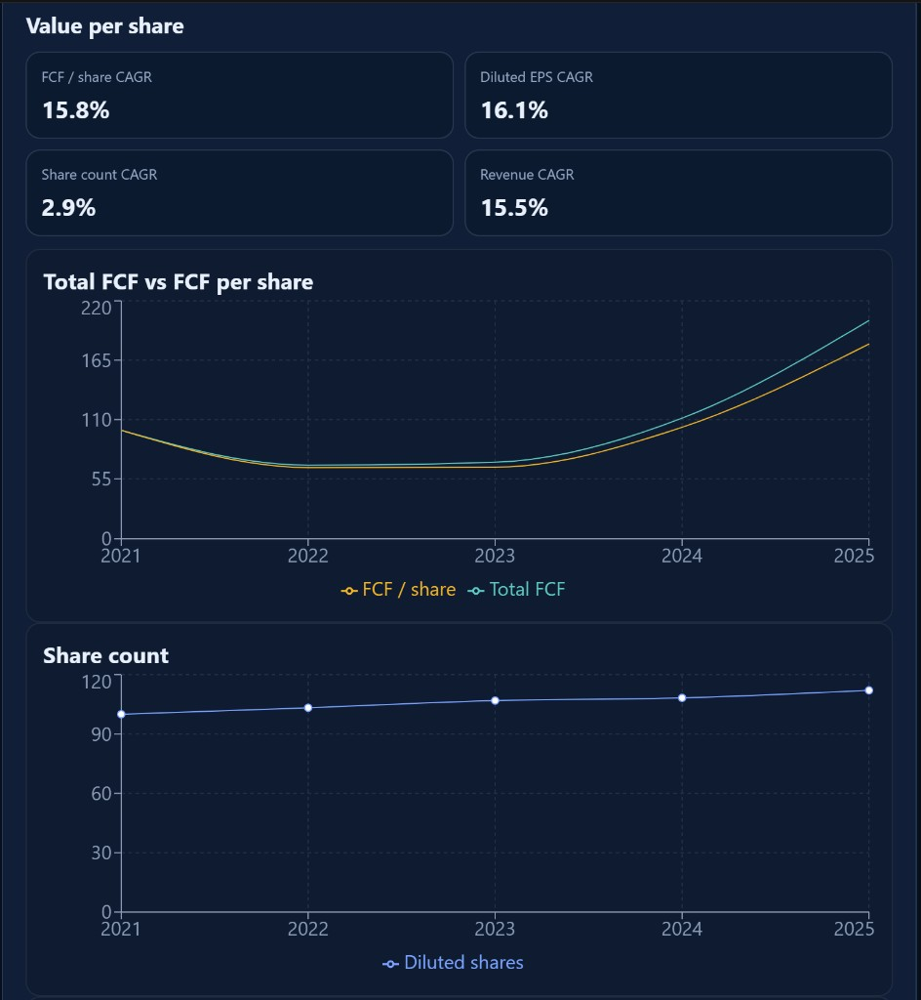

# Investech Hackathon Starter

**Competitive Edge** + **WSP Index Admission Analysis** — a Onesheet-backed hackathon app for Investech.

> **Pitch:** Should WSP Global be admitted to the index? The app builds an evidence-based verdict (Admit / Watch / Reject) from peers, value-per-share, deal execution, and index fit — with an offline snapshot when the live API is unavailable.

| | |
| --- | --- |
| **Local app** | http://localhost:5173 |
| **Live demo** | https://investech-hackathon-starter.vercel.app |
| **Repo** | https://github.com/Taganas2002/investech-hackathon-starter |

### Important: offline snapshot mode

The organizer **stopped / revoked live Onesheet API keys** for this demo. The app therefore **defaults to Offline snapshot** and loads the saved toolkit data under `trimestre-toolkit/dashboard_data`.

- Leave **Offline snapshot** checked to browse Decision, Glance, Peers, Deals, etc.
- Competitive Edge still has **Demo Data** (no API key required).
- Live Onesheet calls will return **401** until a new valid key is provided.

---

## What you get

1. **WSP Index Admission** (default view)  
   Decision · Glance · Acquisitions · Peers · Value per share · Deal execution · Index fit  
2. **Competitive Edge**  
   Sector peer ranking from demo data, CSV import, or the Onesheet API

---

## Screenshots

<p align="center">
  
</p>

<details>
<summary><strong>More screenshots</strong> (Glance, Peers, Value per share, Deals)</summary>





Full gallery: [`docs/README.md`](docs/README.md)

</details>

---

## Quick start

You need **two terminals**.

### 1) API server

```bash
cd server
npm install
copy .env.example .env
# edit .env — paste your Onesheet key (see below)
npm run dev
```

Runs on http://localhost:3001

### 2) Frontend

```bash
cd client
npm install
npm run dev
```

Open http://localhost:5173

> Tip: **Offline snapshot is on by default** because live Onesheet keys were stopped. Competitive Edge **Demo Data** also works with no API.

---

## Environment variables

**Never commit real keys.** Use `server/.env` locally and Vercel → Settings → Environment Variables in production.

### Server — `server/.env`

```env
PORT=3001
ORGANIZER_API_URL=https://api.onesheet.pro/v1
ORGANIZER_API_KEY=your_onesheet_key
ONESHEET_API_KEY=your_onesheet_key
```

| Variable | Required | Notes |
| --- | --- | --- |
| `ORGANIZER_API_URL` | Yes (live) | Onesheet base URL |
| `ORGANIZER_API_KEY` | Yes (live) | Server-only secret |
| `ONESHEET_API_KEY` | Yes (live) | Same key; used by WSP routes |
| `PORT` | No | Defaults to `3001` |

### Client — optional `client/.env`

| Variable | Notes |
| --- | --- |
| `VITE_API_BASE_URL` | Leave **empty** locally and on Vercel Services |
| `VITE_API_KEY` | Do **not** put Onesheet secrets here (visible in the browser) |

---

## How the modes work

| Mode | Needs API key? | Notes |
| --- | --- | --- |
| WSP **Offline snapshot** (default) | No | Reads `trimestre-toolkit/dashboard_data` — use this while keys are stopped |
| WSP **live** | Yes | `/api/wsp/*` → Onesheet (returns 401 if key revoked) |
| Competitive Edge **Demo Data** | No | Fictional companies in the client |
| Competitive Edge **Load API** | Yes | Proxied company feed |

---

## Deploy on Vercel

This repo uses **Vercel Services** (`vercel.json` at the root):

| Service | Framework | Public path |
| --- | --- | --- |
| `client` | Vite | `/` |
| `server` | Express | `/api/*` |

1. Import the GitHub repo in Vercel (Root Directory `./`, Services preset).
2. Add env vars: `ORGANIZER_API_URL`, `ORGANIZER_API_KEY`, `ONESHEET_API_KEY`.
3. Deploy. Leave `VITE_API_BASE_URL` empty.
4. After changing env vars, **Redeploy**.

Check health: `https://<your-app>.vercel.app/api/health`  
You want `"apiKeyConfigured": true`.

---

## Project layout

```text
client/                 React + Vite UI (WSP pages + Competitive Edge)
server/                 Express proxy + /api/wsp routes
trimestre-toolkit/      Offline dashboard_data (+ research scripts)
docs/screenshots/       Product screenshots for this README
sample-data/            CSV samples for Competitive Edge import
vercel.json             Multi-service Vercel config
```

---

## Security notes (public repo)

| Safe to publish | Keep private |
| --- | --- |
| Source code & screenshots | `server/.env` (gitignored) |
| Empty `.env.example` files | Real Onesheet API keys |
| Offline `dashboard_data` CSVs/JSON | Excel outputs (ignored / removed) |

API keys belong only in local `.env` or Vercel env settings — never in client code or docs.

---

## Scripts

```bash
cd client && npm run dev      # UI
cd client && npm run build    # production build
cd server && npm run dev      # API
```

---

## Team notes

- WSP navigation uses hash routes (`#/decision`, `#/peers`, …).
- Offline snapshot is the reliable hackathon fallback when Onesheet keys rotate or rate-limit.
- Competitive Edge field mapping lives in `client/src/dataAdapter.ts`.
