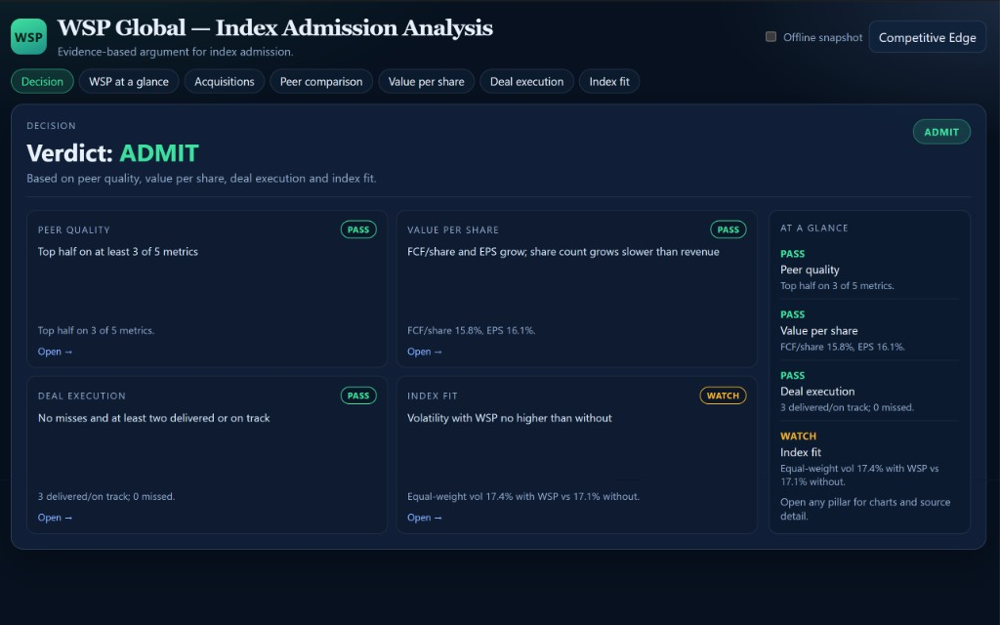
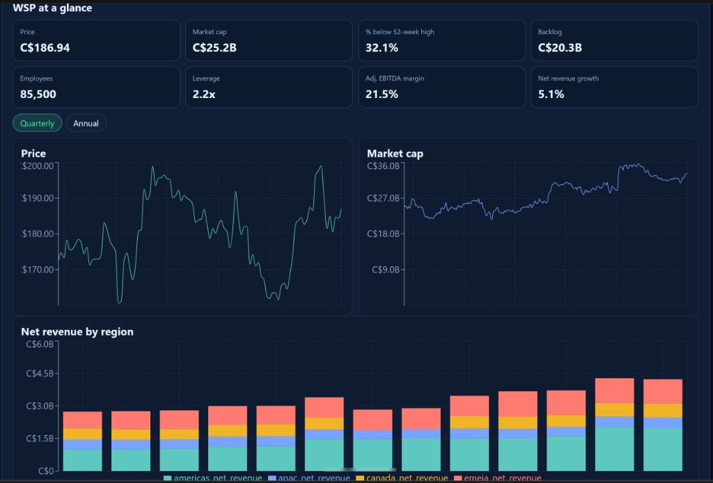
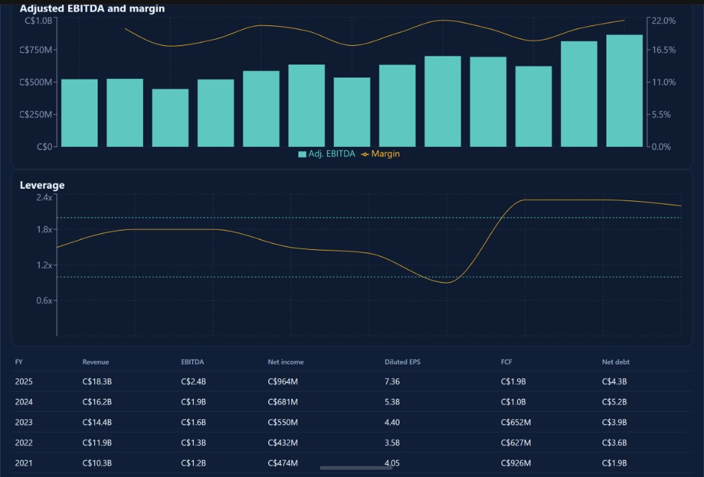
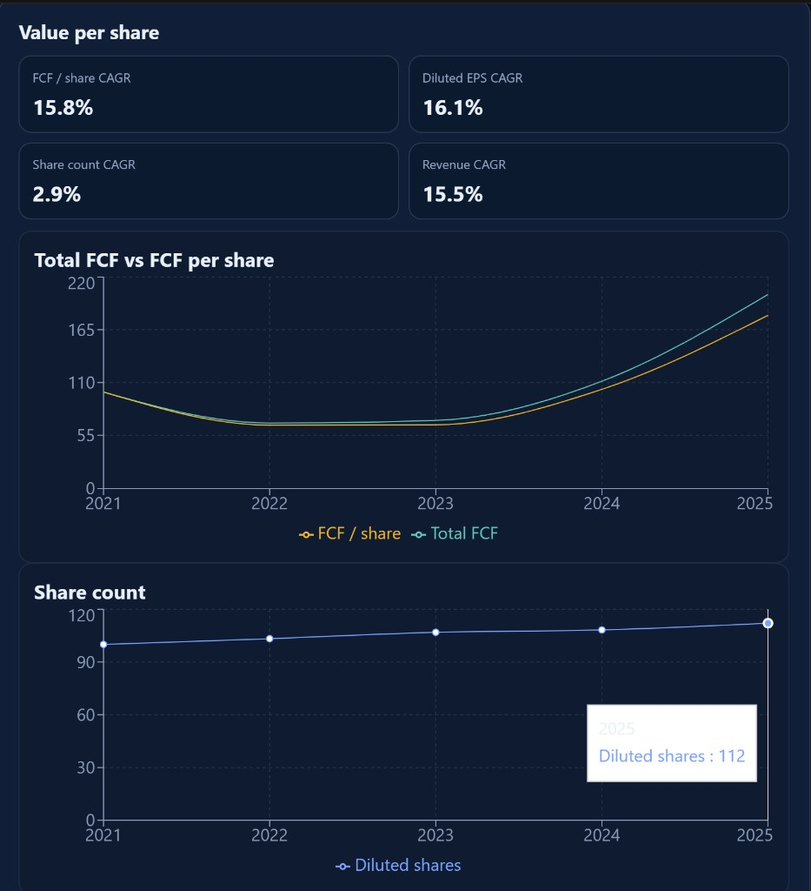

# Investech Hackathon — Competitive Edge + WSP Index Admission

Hackathon app for Investech / Onesheet.

1. **WSP Index Admission Analysis** — evidence panels for whether WSP Global fits index admission (decision, glance, peers, value per share, deals, index fit).
2. **Competitive Edge** — sector peer ranking from demo data, CSV import, or the Onesheet-backed API.

Live demo (when deployed): use the Vercel URL for this repo. Local: `http://localhost:5173`

## Screenshots

### Decision



### WSP at a glance





### Value per share




More images: [`docs/README.md`](docs/README.md)

## Quick start

### Frontend

```bash
cd client
npm install
npm run dev
```

Open http://localhost:5173

### Backend (needed for live Onesheet + offline WSP snapshot)

```bash
cd server
npm install
copy .env.example .env
npm run dev
```

Proxy: http://localhost:3001  
In dev, Vite forwards `/api` to the proxy.

## Environment variables

**Never commit real keys.** Put secrets only in `server/.env` (gitignored) or Vercel env settings.

### `server/.env`

| Variable | Purpose |
| --- | --- |
| `ORGANIZER_API_URL` | `https://api.onesheet.pro/v1` |
| `ORGANIZER_API_KEY` | Onesheet key (server only) |
| `ONESHEET_API_KEY` | Same key (used by WSP live routes) |
| `PORT` | Default `3001` |

### `client/.env` (optional)

| Variable | Purpose |
| --- | --- |
| `VITE_API_BASE_URL` | Leave empty locally and on Vercel Services (same-origin `/api`) |
| `VITE_API_KEY` | Do **not** put Onesheet secrets here — visible in the browser bundle |

## Modes

| Mode | What it does |
| --- | --- |
| WSP live | Calls Onesheet via Express (`/api/wsp/*`) |
| WSP **Offline snapshot** | Serves `trimestre-toolkit/dashboard_data` (works if the API key is down) |
| Competitive Edge **Demo Data** | Fictional companies in the client — no API required |
| Competitive Edge **Load API** | Proxied Onesheet company feed |

## Deploy (Vercel Services)

Root `vercel.json` defines two services:

- `client` (Vite) at `/`
- `server` (Express) at `/api/*`

Set `ORGANIZER_API_URL`, `ORGANIZER_API_KEY`, and `ONESHEET_API_KEY` in Vercel, then deploy. Leave `VITE_API_BASE_URL` empty.

## What’s safe to publish

- App source and screenshots — OK  
- Empty `.env.example` files — OK  
- `trimestre-toolkit/dashboard_data` — public-company metrics for the offline demo  
- **Not in git:** `server/.env`, Excel workbooks under `trimestre-toolkit/output/`  

API keys must stay in Vercel / local `.env` only.

## Project layout

```text
client/                 React + Vite UI
server/                 Express Onesheet proxy + WSP routes
trimestre-toolkit/      Offline dashboard_data (+ research scripts)
docs/screenshots/       Product screenshots
sample-data/            CSV samples for Competitive Edge import
```

## Scripts

```bash
cd client && npm run dev
cd client && npm run build
cd server && npm run dev
```
