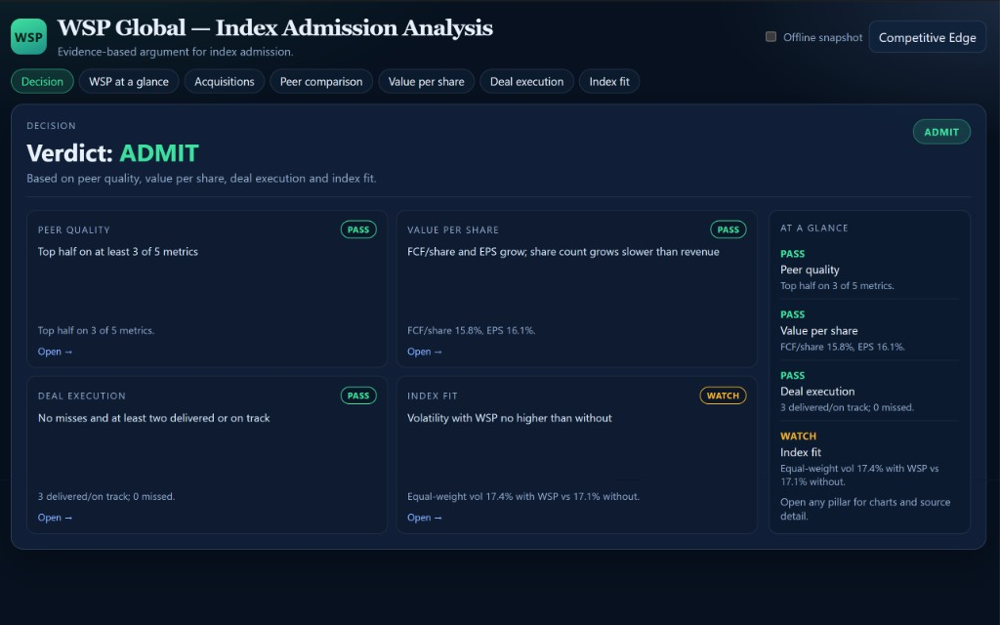
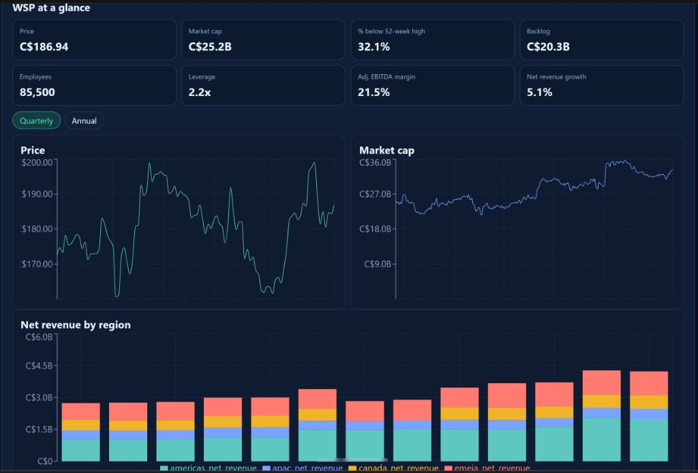
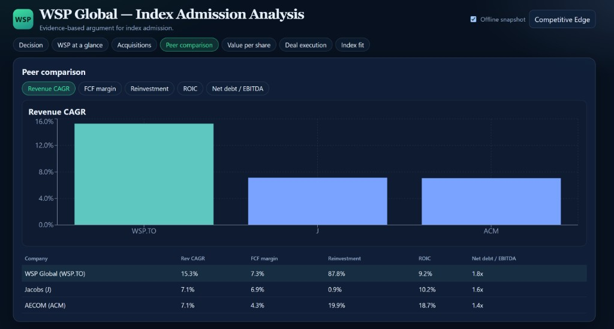
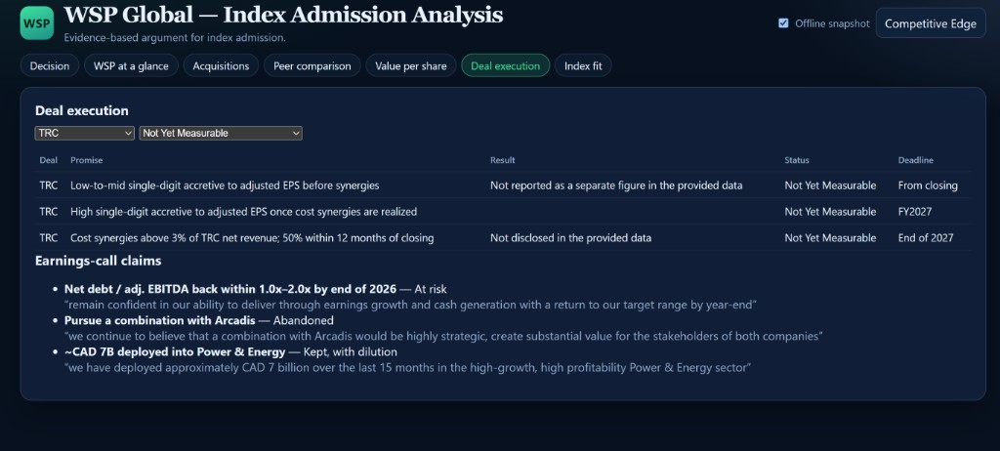

# Documentation & screenshots

Visual tour of **WSP Index Admission Analysis**.  
These images show the UI only — **no API keys** are included.

Back to the main guide: [README.md](../README.md)

---

## 1. Decision

Admission verdict and the four pillars (peer quality, value per share, deal execution, index fit).



---

## 2. WSP at a glance

Headline KPIs: price, market cap, backlog, employees, leverage, margins, growth.



Price / market-cap trends, regional revenue, EBITDA, leverage, and statements.


---

## 3. Peer comparison

WSP vs peer set on growth, FCF margin, reinvestment, ROIC, and leverage.



---

## 4. Value per share

FCF/share and EPS CAGRs vs share-count growth.


---

## 5. Deal execution

Acquisition promises, status tracking, and earnings-call claims.



---

## How to run (short)

```bash
# Terminal 1
cd server && npm install && copy .env.example .env && npm run dev

# Terminal 2
cd client && npm install && npm run dev
```

Open http://localhost:5173  
If live Onesheet fails, enable **Offline snapshot**.

## Deploy

See the **Deploy on Vercel** section in the root [README.md](../README.md).
